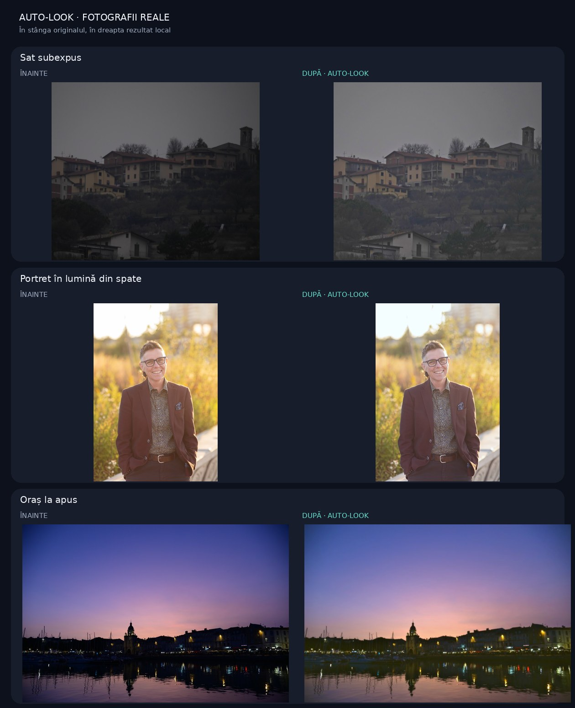

# Probe foto reale pentru editorul automat

Fotografiile de aici sunt exemple reale, nu imagini desenate. Sunt folosite ca material de verificare vizuală locală pentru aceeași funcție `renderLook` folosită de testele editorului. Nicio fotografie nu este trimisă la server de aplicație.

Grila cu toate cele 20, cu verdictul pe fiecare („mai bună” sau „nu e mai bună”), este [`docs/editor-before-after.jpg`](../editor-before-after.jpg). Licențele sunt în [`LICENSES.md`](LICENSES.md). Cifrele sunt în [`bench-results.json`](bench-results.json). Se regenerează cu `npx tsx scripts/render-editor-bench.ts`.

Pentru a recrea rezultatele înainte/după:

```bash
python3 -m pip install Pillow
npx --yes tsx scripts/render-real-photo-samples.ts
```

Scriptul citește cele trei fișiere JPEG, aplică algoritmul local din `src/core/renderLook.ts` și scrie versiunile „după” în `rendered/` plus valorile măsurate în `results.json`. Portretul auriu are fața deja deschisă, deci relight-ul rămâne 0 acolo, intenționat: nu se răcește aurul. Portretul la fereastră, din cele 20, este proba în care fața din umbră se deschide. Fețele din grilă sunt marcate manual; detectarea nativă nu e testată aici.



Cifrele curente, inclusiv cele 20, sunt în [`bench-results.json`](bench-results.json). Cele trei de mai jos rămân pentru scriptul vechi.

## Imagini și licențe

Toate copiile din această mapă au fost redimensionate pentru teste și salvate fără metadate EXIF. Copiile și rezultatele derivate sunt distribuite conform licenței CC BY-SA 4.0 indicate pentru fiecare sursă. Autorii nu susțin și nu au aprobat aplicația.

- `underexposed-photo.jpg` — Dawid Skalec, [Underexposed photo](https://commons.wikimedia.org/wiki/File:Underexposed_photo.JPG), [CC BY-SA 4.0](https://creativecommons.org/licenses/by-sa/4.0/). Fotografie subexpusă a unui sat.
- `backlit-headshot.jpg` — SugarShackfilm / Guochen Wang, [MoBradleyHeadShot backlit small](https://commons.wikimedia.org/wiki/File:MoBradleyHeadShot_backlit_small.jpg), [CC BY-SA 4.0](https://creativecommons.org/licenses/by-sa/4.0/). Portret în contralumină.
- `city-backlight.jpg` — Ddgfoto, [City backlight](https://commons.wikimedia.org/wiki/File:City_backlight.jpg), [CC BY-SA 4.0](https://creativecommons.org/licenses/by-sa/4.0/). Oraș fotografiat în contralumină la apus.

## Limită de validare

Aceste exemple arată ce produce rutina locală pe fotografii reale. Nu acoperă întregul `autoEnhance` din interfață, detectarea nativă a feței sau variația dintre telefoane. Nu înlocuiesc testarea pe un telefon Android cu fotografii dintr-o galerie reală și nu sunt un test de acceptanță realizat de utilizator. Înaintea unei lansări trebuie verificată vizual fiecare pereche înainte/după și întregul flux de import, selecție și salvare pe telefon.
